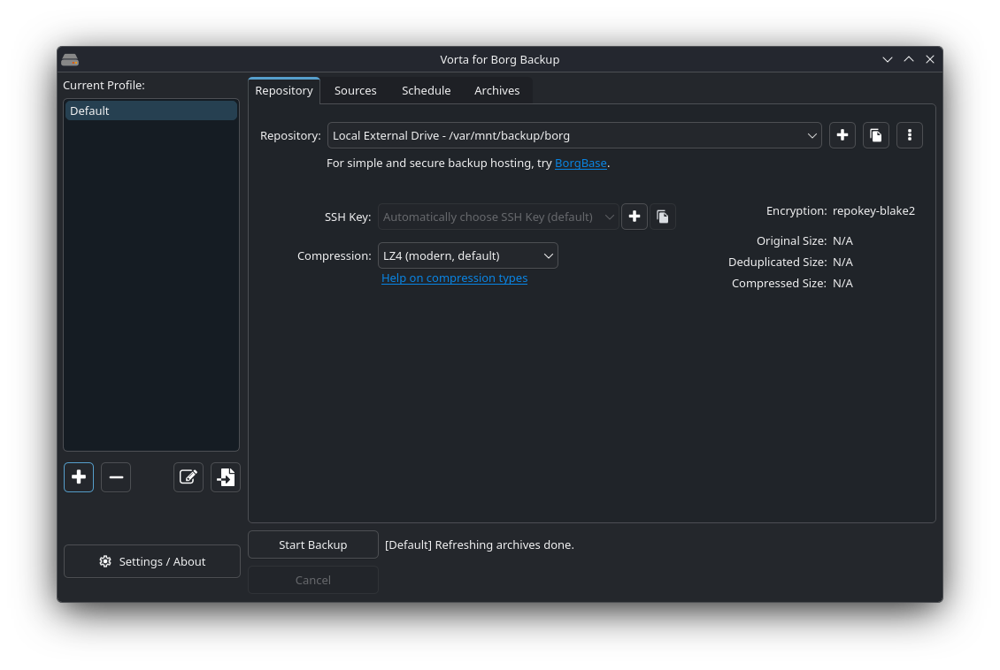
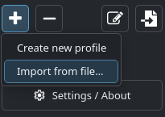
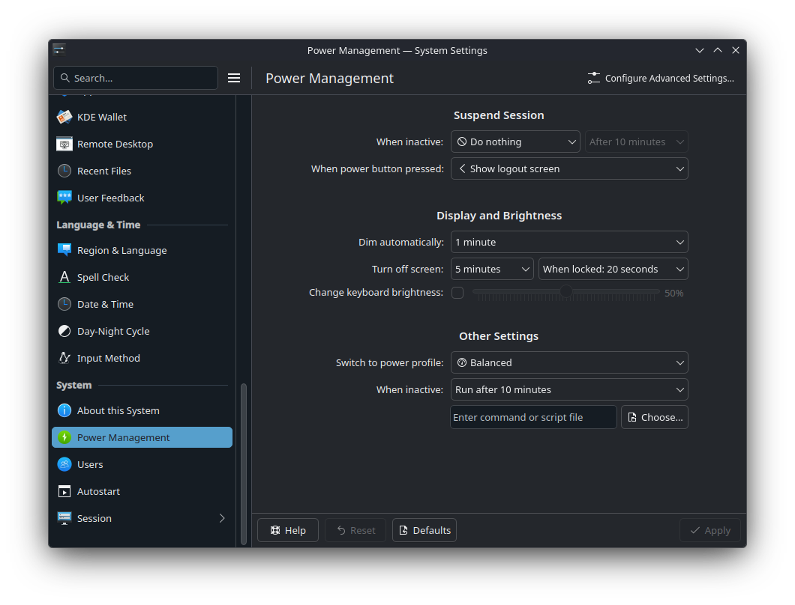

# Bazzite Setup Guide
Various setup tasks after installation is complete.

## Additional Drives (Internal and External)
Assumes a drive is already formatted as a LUKSv2-encrypted Btrfs partition.

https://wiki.archlinux.org/title/Systemd-cryptenroll#Trusted_Platform_Module
```sh
# Ensure TPM device is usable
systemd-cryptenroll --tpm2-device=list

# Link TPM to LUKS container
sudo systemd-cryptenroll --tpm2-device=auto /dev/sdb1 # or /dev/nvme1n1p1

# Ensure TPM keyslot was added
sudo cryptsetup luksDump /dev/sdb1 # or /dev/nvme1n1p1
```

https://wiki.archlinux.org/title/Dm-crypt/System_configuration#Unlocking_in_late_userspace
```sh
# Look for LUKS container UUID
sudo blkid /dev/sdb1 # or /dev/nvme1n1p1

# Add line for backup drive (replace <uuid> with actual UUID):
# luks-<uuid> UUID=<uuid> none nofail         # for HDD
# luks-<uuid> UUID=<uuid> none nofail,discard # for SSD
sudo vim /etc/crypttab

# Add line for backup drive (replace <uuid> with actual UUID):
# /dev/mapper/luks-<uuid> /mnt/<mount-name> btrfs nosuid,nodev,nofail,noatime,x-gvfs-show,compress=zstd 0 0
sudo vim /etc/fstab
```

## Vorta
Import settings from `~/.dotfiles/configs/vorta/vorta.json`.

## Configure NextDNS
https://my.nextdns.io

```bash
# Update according to NextDNS dashboard instructions
sudo vim /etc/systemd/resolved.conf
```

## Configure Vorta


From the main Vorta window, click the "+" button to create a new profile.



Import the `~/.dotfiles/configs/vorta/vorta.json` config.

## Configure Steam Game Recordings
https://store.steampowered.com/gamerecording#:~:text=Where%20are%20my%20recordings

> Game recordings (and their timeline) are shown in the in-game Overlay and in your Recordings & Screenshots viewer.
> From the Steam Desktop Client select View > Recordings & Screenshots. From your Steam Deck, select the Media tab from
> the main menu. You'll find the same content and capabilities in both places.
>
> You can choose where your recordings are stored on your hard drive from Steam > Settings > Game Recording. Steam is
> capturing both the video and the timeline in a raw format, if you'd like a video format (mp4) of your gameplay then
> you'll need to create a clip and export it.

## Configure Power Management
https://docs.kde.org/trunk_kf6/en/powerdevil/kcontrol/powerdevil/index.html



### Prevent Sleep
https://docs.kde.org/trunk_kf6/en/powerdevil/kcontrol/powerdevil/index.html#:~:text=Settings-,Suspend,happened%2E

Select "Do nothing" for the "When inactive" setting.

### Save Power While Idle
https://docs.kde.org/trunk_kf6/en/powerdevil/kcontrol/powerdevil/index.html#:~:text=Switch,produce%2E

Select "Balanced" for "Switch to power profile" setting. The `steam-power-profile-watch` systemd service will switch to
the Performance power profile when running games through Steam, and to the Power Save profile when the desktop is
locked.
